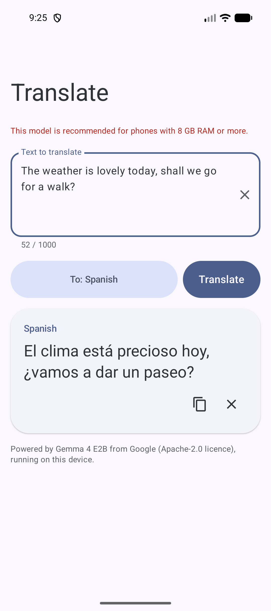
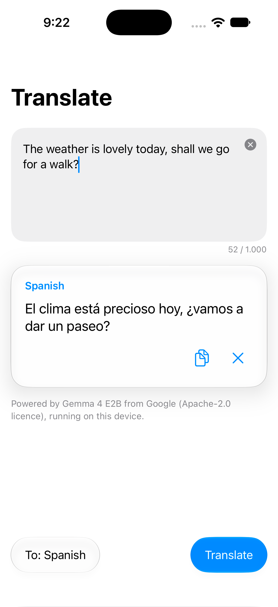

# llm-on-mobile-device

| Android | iOS |
|:---:|:---:|
|  |  |

A minimalist **on-device translator** for Android and iOS. It runs **Gemma 4 E2B** locally with [LiteRT-LM](https://github.com/google-ai-edge/LiteRT-LM) (CPU backend, thinking off).

- Type or paste text in any language, pick a target language, get a streamed translation.
- Internet is used **once**, on first launch, to download the model (~2.6 GB) from Hugging Face. After that the app is fully offline (works in airplane mode).
- No analytics, telemetry or any other network call. Your text never leaves the device.

> **Status:** work in progress. The implementation follows [`SPEC.md`](SPEC.md) milestone by milestone.

## Branch `walter`: Traductor Walter

This branch builds **Traductor Walter** (`dev.heikki.walter`), a variant for a Spanish-only speaker talking with one coworker on construction sites. It adds **voice**: two big buttons ("Hablo yo" / "Habla él"), on-device speech recognition and translation by Gemma 4 E2B's audio encoder, translations read aloud with the phone's offline voices, automatic detection of the coworker's language, and the language remembered between uses. The UI is in Spanish. See [`SPEC-WALTER.md`](SPEC-WALTER.md).

- Same model and one-time download as the main app; still fully offline afterwards. Audio is processed on the phone and deleted right away.
- Extra Android permission: `RECORD_AUDIO` (asked on the first mic tap).
- Install the Spanish voice (and the coworker's, e.g. Urdu) once, on Wi-Fi: Android *Settings → Accessibility → Text-to-speech output → Speech Services by Google → Install voice data*; iOS *Settings → Accessibility → Spoken Content → Voices*. Languages without an offline voice are shown in large text instead.

## Apps

| Platform | Folder | Stack | Requirements |
|---|---|---|---|
| Android | `android/` | Kotlin, Jetpack Compose, Material 3 Expressive | `compileSdk`/`targetSdk` 37 (Android 17), `minSdk` 26, JDK 17+ |
| iOS | `ios/` | Swift, SwiftUI, Liquid Glass | iOS 27, Xcode 27 |

**Devices:** 8 GB RAM recommended; ~2.8 GB free storage for the first download.

## Model

| | |
|---|---|
| Model | [`litert-community/gemma-4-E2B-it-litert-lm`](https://huggingface.co/litert-community/gemma-4-E2B-it-litert-lm) → `gemma-4-E2B-it.litertlm` |
| Size | 2,588,147,712 bytes |
| SHA-256 | `181938105e0eefd105961417e8da75903eacda102c4fce9ce90f50b97139a63c` |
| Licence | [Apache-2.0](https://www.apache.org/licenses/LICENSE-2.0) (not gated). Gemma is provided by Google. |

The model is downloaded by the app at runtime and is **never** committed to this repo or bundled in the apps.

## First run

1. Open the app. It shows a download screen (2.6 GB, Wi-Fi recommended, ~2.8 GB free space needed).
2. Tap **Download** and keep the app open. On mobile data it asks first. Cancelled or interrupted downloads resume where they stopped.
3. The file is checked (size and SHA-256), loaded, and the translator appears. Later launches go straight to the translator, fully offline.

The only network request the apps ever make is that download (`ModelDownloader.kt` / `ModelDownloader.swift`). Your text is never sent anywhere and is not stored; only the last target language is remembered.

## Build and run

**Android** (Android Studio, or the command line with JDK 17+ and the Android SDK):

```sh
cd android
./gradlew assembleDebug        # build
./gradlew testDebugUnitTest    # unit tests
./gradlew installDebug         # install on a connected device or emulator
```

**iOS** (Xcode 27 on Apple Silicon): open `ios/Translator.xcodeproj`, pick the `Translator` scheme and run. From the command line:

```sh
cd ios
xcodebuild -scheme Translator -destination 'generic/platform=iOS Simulator' build
xcodebuild test -scheme Translator -destination 'platform=iOS Simulator,name=<iPhone simulator>' CODE_SIGNING_ALLOWED=NO
```

To run on a physical iPhone, set your own team and bundle ID (`dev.heikki.translator` is a placeholder) in the target's Signing settings.

## Known limits

- **Big first download:** 2.6 GB from Hugging Face, foreground only (keep the app open). If Hugging Face removes or gates the file, new installs can't download it; installed apps keep working.
- **Memory:** 8 GB RAM recommended; on smaller phones translation can be slow or the app may be closed by the system. A warning is shown.
- **CPU only:** the apps use the LiteRT-LM CPU backend; GPU is not enabled.
- **Input:** up to 1,000 characters per translation; each translation is independent (no conversation history).
- **Quality:** a small on-device model; translations can be imperfect, especially for long or idiomatic text.
- **iOS:** LiteRT-LM for Swift is an early preview; the simulator build is arm64 only (Apple Silicon Macs).

## Docs

- [`SPEC.md`](SPEC.md): full specification and milestones (source of truth).
- [`AGENTS.md`](AGENTS.md): rules for coding agents.

## Testing on emulator / simulator

Besides unit tests, the apps are checked end to end on the Android emulator and the iOS Simulator by driving the real UI from the command line, so coding agents can do it too:

- **Android:** `adb` (`uiautomator dump` to read the screen, `input tap` / `input text` to interact, `screencap` for screenshots).
- **iOS:** [AXe](https://github.com/cameroncooke/AXe) for UI interaction (`describe-ui`, `tap`, `type`, `screenshot`), plus `xcodebuild` or Xcode's MCP server (`xcrun mcpbridge`) for building, running and logs.

The app performs its own first-run model download there; nothing fetches the model separately. Details in [`AGENTS.md`](AGENTS.md).

## CI

GitHub Actions build the apps and run the unit tests (`.github/workflows/android.yml`, `.github/workflows/ios.yml`). They never download the model.
